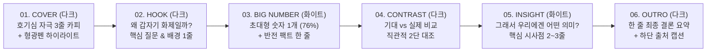
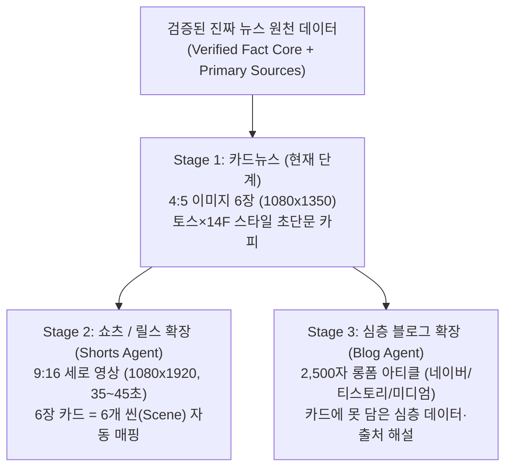

# 진짜 뉴스 생성 & OSMU(카드뉴스 → 쇼츠 → 블로그) 에이전트 마스터 플랜

> **핵심 비전**: 에이전트가 백그라운드에서 스스로 가짜뉴스·과장 루머를 필터링(1차 출처 교차검증)하고, 검증된 **'진짜 뉴스(One Source)'** 하나를 바탕으로 **① 카드뉴스(Instagram/Threads) → ② 숏폼 영상(Shorts/Reels) → ③ 심층 블로그(Blog/Newsletter)**까지 원스톱으로 확장하는 **OSMU(One Source Multi-Use) 콘텐츠 파이프라인**

---

## 1. 확정된 디자인 & 운영 원칙

1. **백그라운드 팩트 필터링 (Silent Fact-Check)**:
   - 가짜뉴스 판별과 1차 출처(논문, 공식 기술 블로그, 정부 발표, 주요 통신사) 교차검증은 에이전트가 내부적으로 수행합니다.
   - 카드뉴스 이미지 표면에는 `"팩트체크 판정"`, `"교차검증 완료"` 같은 딱딱한 메타 문구를 일절 노출하지 않고 **순수하게 뉴스 본연의 흥미로운 스토리와 핵심 숫자**만 담습니다.
2. **확정 카드뉴스 디자인: 스타일 A [토스 피드 × 14F 하이브리드]**
   - **타이포그래피**: `NotoSansKR-VF Black(900)` + 타이트한 자간(`-3 ~ -4px`) + 압도적 스케일 대비
   - **레이아웃**: 50% 이상의 여백 + **딥블랙(`#090A0F`) ↔ 오프화이트(`#F4F4F6`) 슬라이드 배경 반전** + 도메인별 시그니처 **형광펜 하이라이트 마커**(AI·테크: 네온 라임 `#D4FF00`)
   - **카피 분량**: **1슬라이드 = 1메시지** (2~3줄, 40~50자 이내, 직관적 비유 활용)

---

## 2. 분야별 도메인 레지스트리 (우선순위 + 향후 확장 저장본)

| 순위 | 도메인 코드 | 분야명 | 상태 | 스타일 A 전용 형광펜 포인트 컬러 | 주요 1차 검증 출처 (내부 필터링용) |
| :---: | :--- | :--- | :---: | :--- | :--- |
| **1** | **`ai-tech`** | **AI · 테크 · 과학** | **🔥 Active** | **Neon Lime** (`#D4FF00`) | OpenAI/DeepMind/Anthropic 공식 리포트, arXiv, Nature, IEEE, KISA |
| **2** | **`economy`** | **경제 · 금융 · 부동산** | 📦 Saved | **Electric Cyan** (`#00F0FF`) | 한국은행, 기재부, 통계청(KOSIS), 금융위, 연준(Fed), Bloomberg |
| **3** | **`health`** | **건강 · 의학 · 식품안전** | 📦 Saved | **Mint Green** (`#00FF88`) | 질병관리청, 식약처, WHO, FDA, PubMed / NEJM / Lancet |
| **4** | **`society`** | **사회 · 정책 · 법률** | 📦 Saved | **Vivid Coral** (`#FF3366`) | 대한민국 정책브리핑, 국회 의안정보시스템, 법제처, 대법원 |
| **5** | **`global`** | **글로벌 국제정세 · 기후** | 📦 Saved | **Amber Yellow** (`#FFB800`) | Reuters, AP, AFP, 연합뉴스, IEA, UN 공식 보고서 |

---

## 3. 스타일 A 카드뉴스 6장 표준 스토리텔링 구조

복잡한 박스를 없애고 독자가 15초 만에 끝까지 넘겨보게 만드는 **6장 정석 호흡**입니다.

---

## 4. [확장 계획 저장] One-Source Multi-Use: 카드뉴스 → 쇼츠 → 블로그 파이프라인

하나의 주제를 검증해 만든 데이터(`storyboard.json` + 1차 출처 팩트 패키지)를 그대로 재활용하여 **쇼츠(영상)**와 **블로그(장문 아티클)**로 자동 확장하는 3단계 아키텍처입니다.

### Stage 1 → Stage 2: 카드뉴스에서 **쇼츠/릴스(Shorts/Reels)**로 확장 계획
- **구조 매핑 (1 Card = 1 Scene)**:
  - **Scene 01 (0~4초 / 초반 후킹)**: 카드뉴스 1장(표지)의 강렬한 3줄 카피를 그대로 첫 3초 음성 후킹(`Hook Narration`) + 대형 중앙 자막으로 배치
  - **Scene 02~05 (4~35초 / 본론 전개)**: 카드뉴스 2~5장의 핵심 문장과 초대형 숫자(`76%` 카운트업 모션)를 `1080×1920` (`9:16`) 세로 캔버스용 모션 슬라이드/B-roll과 매칭
  - **Scene 06 (35~45초 / 루프 아웃트로)**: 카드뉴스 6장의 한 줄 결론 + 댓글 유도 질문(CTA)
- **산출물 예정 (`output/YYYYMMDD_<slug>/shorts/`)**:
  - `shorts_script.json` & `shorts_script.md`: 타임코드별 나레이션 대본(TTS용), 화면 자막, 효과음(SFX)/시각 연출 지시서
  - `frames/scene_01~06.png`: `1080×1920` (9:16) 쇼츠용 세로 키프레임 그래픽 (또는 TTS 음성 + FFmpeg 결합 MP4 자동 렌더링)

### Stage 1 → Stage 3: 카드뉴스에서 **블로그(Blog/Newsletter)**로 확장 계획
- **역할 분담**:
  - 카드뉴스와 쇼츠가 **'빠른 훅(Hook)과 핵심 요약'**으로 유입을 만든다면, 블로그는 백그라운드에서 수집한 **1차 출처(논문 수치, 공식 보고서 맥락, 배경 지식)를 깊이 있게 풀어내는 롱폼 아티클** 역할을 맡습니다.
- **블로그 자동 구성 포맷 (`output/YYYYMMDD_<slug>/blog_post.md` & `blog_post.html`)**:
  1. **SEO 최적화 제목 3종 제안** (검색 유입형 / 호기심 유발형 / 전문 리포트형)
  2. **도입부 (Lead)**: 화제가 된 배경과 핵심 결론 두괄식 요약 (카드뉴스 표지 이미지 자동 삽입)
  3. **본론 1·2·3 (Deep Dive)**: 카드뉴스에서는 2줄로 압축했던 실제 논문/공식 발표의 세부 실험 조건, 수치 비교 표, 업계 맥락 상세 해설 (중간에 카드뉴스 본문 이미지들을 인포그래픽 삽화로 자동 배치)
  4. **시사점 및 전망 (Editor's Note)**: 현업/독자가 챙겨야 할 실전 인사이트
  5. **참고문헌 및 원문 링크 (References)**: 교차검증에 사용된 1차 출처 원문 링크 완벽 정리
