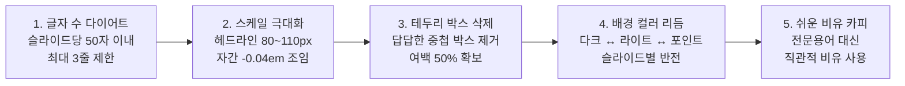

# 유명 카드뉴스 벤치마킹 & 리디자인 분석서 (Card News Benchmark)

> **목적**: 첫 번째 시안이 왜 **"내용이 정신없고 디자인이 올드해 보였는지"** 냉정하게 진단하고, 국내외 톱티어 카드뉴스 브랜드(**토스 피드 · 14F · 뉴닉 · Vox/Economist · 폴인**)의 실제 레이아웃과 카피라이팅 공식을 벤치마킹하여 **눈에 확 꽂히는 트렌디한 포맷**을 재정의합니다.

---

## 1. 기존 시안이 '정신없고 올드해 보인' 4가지 원인 진단

| 진단 항목 | 기존 1차 시안의 문제점 (Before) | 유명 카드뉴스의 공식 (After) |
| :--- | :--- | :--- |
| **① 정보 밀도 (글자 수)** | 한 장에 박스 3~4개 + **180~220자**를 빽빽하게 넣음 → **요약 PPT나 공공기관 보고서**처럼 보임 | **1슬라이드 = 단 1개의 메시지 (40~60자 이내)** 본문은 큰 글씨 **2~3줄**에서 무조건 끝냄 |
| **② 레이아웃 & 여백** | 모든 텍스트를 **네모난 박스 테두리** 안에 가둠 → 숨 쉴 공간(여백)이 없어 답답함 | **여백(Negative Space) 50% 이상 확보** 불필요한 테두리 박스를 없애고 큼직한 타이포 자체를 그래픽처럼 배치 |
| **③ 폰트 & 렌더링** | Windows 기본 폰트(`맑은 고딕`) + Python 기본 도형 그리기 → 2010년대 느낌 | **`Pretendard Black(900)` / `Gmarket Sans`** 웹폰트 + 실제 브라우저(Chrome CSS) 렌더링 (자간 `-0.04em` 타이트하게 조임) |
| **④ 배경 리듬감** | 1장부터 7장까지 똑같은 남색 배경만 반복되어 스크롤할 때 지루함 | **배경 컬러 체인지(Color Blocking)**로 시각적 반전 부여 (예: 표지=강렬한 다크/포인트 → 본문=깔끔한 오프화이트 → 반전=비비드 컬러) |

---

## 2. 국내외 유명 카드뉴스 5대 레퍼런스 벤치마킹

### ① 토스 피드 (Toss Feed) · 디에디트 스타일 — *"극강의 여백 & 볼드 타이포형"*
- **핵심 특징**: 화면의 **절반 이상을 과감하게 비우고**, 가장 중요한 **핵심 카피 1~2문장만 초대형 볼드체**로 배치합니다.
- **카피 문법**:
  - ❌ (기존): *"최근 1년 사이 주요 AI 모델의 SWE-bench 점수가 급격히 상승하며 화제가 집중되고 있습니다."*
  - ⭕ (토스식):
    > **"AI가 개발자를 대체한다?"**
    > **80점짜리 성적표의 함정.**
- **디자인 포인트**: 박스 테두리를 거의 쓰지 않고, **초대형 숫자(`76%`)**나 **단 한 줄의 반전 문장**으로 시선을 강탈합니다.

### ② 14F (일사에프) · 스브스뉴스 스타일 — *"형광펜 하이라이트 & 문답(Q&A) 전개형"*
- **핵심 특징**: 친구에게 이야기하듯 **"왜 그럴까?" → "진짜 이유는 따로 있습니다"**처럼 슬라이드마다 꼬리에 꼬리를 무는 질문-답변 구조를 씁니다.
- **디자인 포인트**:
  - 검은색 또는 짙은 배경 위에 **네온 옐로우(`#FFE600`) / 일렉트릭 시안(`#00F0FF`) / 핫 코랄(`#FF3366`)** 형광펜 밑줄(Highlight Marker)을 그어 **핵심 단어 2~3개만 읽어도 전체 맥락이 파악**되게 만듭니다.

### ③ 뉴닉 (NEWNEEK) · 캐릿 스타일 — *"컬러 블록 대비 & 직관적 비유형"*
- **핵심 특징**: 어려운 전문 용어(예: *데이터 오염, Pre-training Leakage*)를 그대로 쓰지 않고 **"수능 치기 전에 기출문제 답안지를 미리 외운 셈"**처럼 일상적인 비유로 바꿉니다.
- **디자인 포인트**:
  - 오렌지, 비비드 블루, 크림 화이트 등 **채도가 높은 배경색 전환**과 큼직한 캡슐 태그를 활용해 스크롤을 멈추게(Thumb-stopping) 만듭니다.

### ④ Vox · The Economist · Chartr 스타일 — *"데이터 스토리텔링 & 매거진 에디토리얼형"*
- **핵심 특징**: 복잡한 표 대신 **단 하나의 압도적인 수치 비교**(예: `암기했을 때 76%` vs `실전 새 문제 23%`)만 화면 중앙에 거대하게 보여줍니다.
- **디자인 포인트**:
  - 매거진 표지처럼 상단에 얇고 세련된 에디토리얼 라인과 세리프/모노스페이스 숫자 포인트를 결합해 **'신뢰할 수 있는 고급 저널리즘'** 인상을 줍니다.

### ⑤ 폴인 (fol:in) · 롱블랙 (Longblack) 스타일 — *"임팩트 인용구(Quote) & 인사이트 카드형"*
- **핵심 특징**: 권위 있는 기관이나 인물의 결정적 한마디(예: *OpenAI 공식 발표문 한 줄*)를 큰 따옴표(`“ ”`)와 함께 영화 포스터 대사처럼 배치합니다.
- **디자인 포인트**: 텍스트 양을 극도로 줄이고, 하단에 깔끔한 출처 캡션만 남겨 공유(Save & Share) 욕구를 자극합니다.

---

## 3. 눈에 확 들어오는 카드뉴스 5대 황금 법칙 (리디자인 기준)

### Before vs After 카피 & 레이아웃 비교 (예시: Slide 03 팩트체크 판정)

| 구분 | ❌ 기존 시안 (정신없고 올드함) | ⭕ 리디자인 시안 (눈에 확 꽂힘) |
| :--- | :--- | :--- |
| **화면에 들어가는 요소** | 상단 바 + 섹션 제목 + 헤드라인 + 4단 미터 박스 + 최종 판정 텍스트 + 파란 요약 박스(4줄) + FACT/MYTH 박스 3개 (**총 11개 덩어리**) | 상단 미니 태그 + **초대형 결론 2줄** + **핵심 비유 서브카피 2줄** (**총 3개 덩어리, 나머지 50%는 여백**) |
| **실제 카피** | *"AI의 코딩 보조 능력이 향상된 것은 사실이나, 80%대 고득점은 과거 공개된 GitHub 정답 코드가 사전학습에 포함된 데이터 오염과 테스트 설계 결함 때문임이 공식 확인되었습니다."* | **[판정: 절반의 가짜]** # **추론을 잘한 게 아니라** # **기출문제를 외운 거였습니다.**  시험 전에 이미 정답지를 본 셈이죠. OpenAI조차 이 시험지를 공식 폐기했습니다. |

---

## 4. 새롭게 적용할 추천 디자인 포맷 3선

아래 3가지 스타일 중 가장 마음에 드는 톤앤매너를 골라주시면(또는 조합), 실제 **Chrome 브라우저 렌더링 + `Pretendard` 웹폰트** 기반으로 완전히 새롭게 뽑아드리겠습니다.

1. **스타일 A: [토스 × 14F 하이브리드] 볼드 미니멀 & 형광펜 임팩트형 (강력 추천)**
   - **특징**: 답답한 박스를 싹 걷어내고, **초대형 볼드 타이포그래피 + 형광펜 하이라이트 + 다크/화이트 배경 반전**으로 모바일에서 1초 만에 읽히는 스타일
2. **스타일 B: [The Economist × Vox] 모던 크림/페이퍼 매거진형**
   - **특징**: 눈이 편안한 **웜 화이트/크림색 종이 질감 배경(`#F7F5F0`)**에 딥 블랙 타이포와 강렬한 레드/블루 포인트 컬러를 쓰는 세련된 글로벌 매거진 스타일 (어두운 배경이 흔한 인스타에서 오히려 눈에 확 띔)
3. **스타일 C: [뉴닉 × 캐릿] 비비드 팝 & 컬러블록 Q&A형**
   - **특징**: 슬라이드마다 강렬한 원색/파스텔 컬러 블록이 바뀌며 친근한 구어체(`"진짜 그럴까?"`, `"결론부터 말하면 아니야!"`)로 술술 읽히는 Z세대 트렌디 스타일
